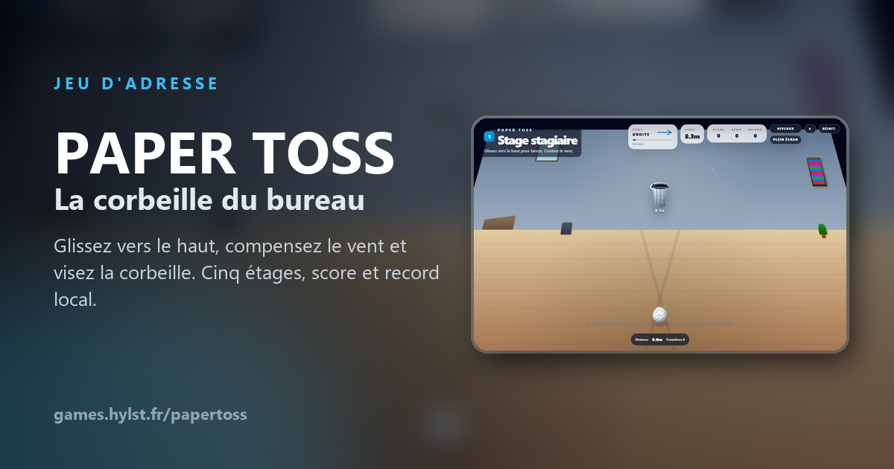

# Paper Toss

**La corbeille du bureau.**

Paper Toss : glissez vers le haut, compensez le vent et visez la corbeille. Cinq étages, score, série et record local.

Joue ici : [games.hylst.fr/papertoss/](https://games.hylst.fr/papertoss/)



## Comment on joue

- Cinq étages, du stage au bureau du patron, avec distance et vent croissants.
- Lancer par glissement, physique du papier, slow motion et retour visuel.
- Score, série, record local persistant (`papertoss-hylst-record`), niveaux à débloquer et plein écran.
- Ambiance sonore et effets générés dans le navigateur.

## Technique

- React 19, TypeScript, Vite 7 et Tailwind CSS 4.
- Build en un seul fichier `index.html`, sans dépendance à l'exécution.
- Aucune requête réseau pendant la partie, aucun compte, aucun cookie.

```bash
npm ci
npm run build
```

Le build sort dans `dist/`. Le fichier `index.html` suffit pour jouer ; `og-image.png` et `icon.webp` accompagnent la publication.

## Structure

```
src/App.tsx             écran, lancer, score
src/game/physics.ts      trajectoire et vent
src/game/levels.ts       cinq étages
src/components/          papier, corbeille, vent
src/sounds/useAudio.ts   sons
```

## Licence

AGPL-3.0-or-later. Voir `LICENSE`.

Jeu créé par Geoffroy (Hylst) avec l'aide d'une IA.
